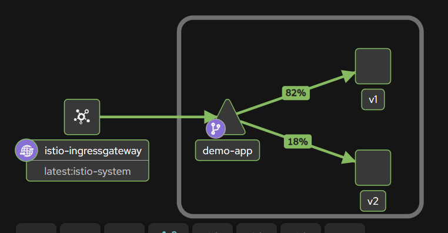

# Kubernetes canary deployment with K3s and Istio

A hands-on simulation of a modern canary release. Two versions of a small app run on K3s, Istio sends **80% of traffic to the stable version and 20% to the canary**, and the traffic is then widened, promoted or rolled back depending on how the canary behaves.



*Kiali graph from the running cluster: the ingress gateway feeds `demo-app`, which splits traffic 82% / 18% between v1 and v2.*

## What it does

- Deploys a Node.js app as **v1 (stable)** and **v2 (canary)** from one Helm chart.
- Uses Istio (`Gateway`, `DestinationRule`, `VirtualService`) to set exact traffic weights.
- Simulates a **bad canary** (50% errors and slow responses), detects it from the numbers, and **rolls back**.
- Shows a **good canary** moving through 80/20, 50/50 and 100% (**promotion**).
- Collects evidence from Envoy access logs and a Kiali traffic graph.

## Tools

K3s, Istio 1.31.x (`default` profile), Helm 3, Docker, Node.js 20, Prometheus and Kiali. Run on one Ubuntu 24.04 EC2 instance (t3.medium).

## Architecture

```
client --> EC2 public IP :80
              |
      Istio ingress gateway          (istio/gateway.yaml)
              |
      VirtualService  80% v1 / 20% v2 (istio/virtual-service.yaml)
              |
      DestinationRule  subsets by version label (istio/destination-rule.yaml)
        /                          \
 Deployment app-stable (v1)    Deployment app-canary (v2)
        \                          /
         one Service: demo-app     (k8s/service.yaml)
```

## Repository layout

| Path | Purpose |
|---|---|
| `app/` | Demo app (`server.js`) and Dockerfile. `APP_VERSION`, `ERROR_RATE` and `DELAY_MS` control its behaviour. |
| `helm/canary-app/` | Helm chart: one Deployment per release |
| `k8s/` | Namespace (with Istio sidecar injection) and the shared Service |
| `istio/` | Gateway, DestinationRule and the 80/20 VirtualService |
| `scripts/set-weights.sh` | Change the traffic split |
| `scripts/load-test.sh` | Count responses per version and HTTP status |
| `docs/` | Project log, strategy document and screenshots |

## Reproduce it

**1. Instance.** Launch Ubuntu 24.04 on a t3.medium (Istio needs more memory than a 1 GB free-tier instance). Security group: SSH (22) from your IP, HTTP (80) from anywhere.

**2. K3s without Traefik** (Traefik would take port 80, which Istio's gateway needs):
```bash
curl -sfL https://get.k3s.io | INSTALL_K3S_EXEC="--disable traefik" sh -
mkdir -p ~/.kube && sudo cp /etc/rancher/k3s/k3s.yaml ~/.kube/config
sudo chown $USER:$USER ~/.kube/config && export KUBECONFIG=~/.kube/config
```

**3. Istio, access logs and add-ons:**
```bash
export ISTIO_VERSION=1.31.1
curl -L https://istio.io/downloadIstio | sh -
cd istio-$ISTIO_VERSION && export PATH=$PWD/bin:$PATH
istioctl install --set profile=default --set meshConfig.accessLogFile=/dev/stdout -y
kubectl apply -f samples/addons/prometheus.yaml -f samples/addons/kiali.yaml
```

**4. Docker, Helm, image.** K3s uses containerd, so the image is copied across:
```bash
sudo apt-get install -y docker.io && sudo usermod -aG docker $USER   # then reconnect
curl -fsSL https://raw.githubusercontent.com/helm/helm/main/scripts/get-helm-3 | bash
docker build -t canary-demo:1.0.0 app/
docker save canary-demo:1.0.0 | sudo k3s ctr images import -
```

**5. Deploy both versions and the Istio config:**
```bash
kubectl apply -f k8s/namespace.yaml -f k8s/service.yaml
helm install app-stable helm/canary-app -n canary-demo --set version=v1
helm install app-canary helm/canary-app -n canary-demo --set version=v2
kubectl apply -f istio/gateway.yaml -f istio/destination-rule.yaml -f istio/virtual-service.yaml
```
Check that the pods show `2/2` (app plus Istio sidecar), then:
```bash
./scripts/load-test.sh http://localhost/ 100
```

## Run the canary

```bash
./scripts/set-weights.sh 80 20     # start the canary
./scripts/set-weights.sh 50 50     # widen it
./scripts/set-weights.sh 0 100     # promote it
./scripts/set-weights.sh 100 0     # roll back
```
Simulate a bad canary:
```bash
helm upgrade app-canary helm/canary-app -n canary-demo \
  --set version=v2 --set env.errorRate=0.5 --set env.delayMs=300
```
Restore it after rolling traffic back: `helm rollback app-canary 1 -n canary-demo`.

To view the Kiali graph, run `kubectl port-forward --address 0.0.0.0 -n istio-system svc/kiali 20001:20001`, allow port 20001 from **your IP only** in the security group, and open `http://<PUBLIC_IP>:20001`. Remove the rule afterwards.

## Results (100 requests per run)

| Stage | Result |
|---|---|
| Baseline 80/20, healthy canary | 78 `v1 200`, 22 `v2 200` |
| Bad canary at 80/20 | 79 `v1 200`, 9 `v2 200`, 12 `v2 500` |
| After sending all traffic to stable | 100 `v1 200` |
| Healthy canary back at 80/20 | 79 `v1 200`, 21 `v2 200` |
| 50/50 | 56 `v1 200`, 44 `v2 200` |
| Promote to 100% canary | 4 `v1 200`, 96 `v2 200` on the first run (Istio had not yet pushed the new rule); re-run: 100 `v2 200` |

The bad canary was contained: stable served all 79 of its requests without error, and every failure came from the canary's small share. Rolling back took one command.

## Deliverables

| Deliverable | Where |
|---|---|
| YAML files for K3s deployment | `k8s/`, `helm/canary-app/` |
| Istio gateway and routing config | `istio/` |
| Traffic logs and metrics dashboard | `docs/PROJECT_LOG.md` (Step 8) and `docs/screenshots/kiali-graph-80-20.png` |
| Canary deployment strategy document | `docs/CANARY_STRATEGY.md` |
| Step-by-step record of the build | `docs/PROJECT_LOG.md` |

## Problems met along the way

| Problem | Cause and fix |
|---|---|
| `istioctl: command not found`, "Unable to get latest Istio version" | The download script could not look up the latest version from the instance. Set `ISTIO_VERSION` explicitly. |
| `permission denied ... docker.sock`, then `ctr: unrecognized image format` | The user was not yet in the `docker` group, so `docker save` sent nothing to K3s. Reconnect (or `newgrp docker`) and rerun. |
| Site stopped loading after stopping and starting the instance | The public IP changes on every stop and start. Use the new IP. |
| First requests after a weight change went to the old version | Istio takes a moment to push the new rule. Pause briefly before measuring. |
| `chmod` not recognised in PowerShell (Windows) | Use `icacls` to restrict the `.pem` key file instead. |

## Limitations

Both versions run the same image, with the canary's behaviour simulated through environment variables. Routing is per request, not per user. Decisions are made by reading the load-test output rather than by automation, and 100 requests only catches large problems. See `docs/CANARY_STRATEGY.md`.

## Cleaning up

Stop the instance when you are not using it. To remove everything: `helm uninstall app-stable app-canary -n canary-demo`, `istioctl uninstall --purge -y`, and `/usr/local/bin/k3s-uninstall.sh`. Delete the EC2 instance when the project is finished.
