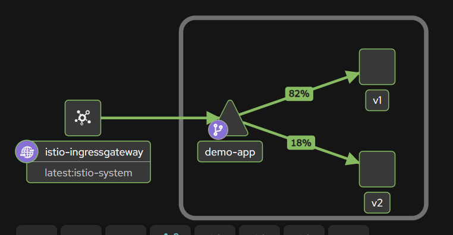

# Project log: Kubernetes canary deployment with K3s and Istio

Every step is recorded here in order. The README and the strategy document are built from this file.

## Objective

Simulate a canary deployment: run a stable and a new version of an app on K3s, use Istio to send 80% of traffic to stable and 20% to the canary, watch the results, then promote or roll back.

## Architecture

```
client --> EC2 public IP :80
              |
      Istio ingress gateway (Gateway)
              |
      VirtualService  (80% v1 / 20% v2)
              |
      DestinationRule (subsets by version label)
        /                      \
 Deployment app-stable (v1)   Deployment app-canary (v2)
```

Design decisions:

- **One image, two releases.** The same Docker image runs both versions. The `APP_VERSION`, `ERROR_RATE` and `DELAY_MS` variables make v2 behave differently, so we can simulate a good canary and a bad one.
- **One Helm chart, installed twice** (`app-stable`, `app-canary`) with different values. The `version` label is what Istio routes on.
- **One Kubernetes Service** for both versions, so Istio, not kube-proxy, decides who gets each request.
- **K3s installed without Traefik.** Traefik takes port 80, which the Istio ingress gateway needs.
- **Image imported into K3s** with `k3s ctr images import`, so no registry account is needed.
- **Instance size.** Istio needs about 2 GB of memory with the lean profile, so a 1 GB free-tier micro instance will not work. Plan for a t3.medium, stopped when not in use.

## Repository layout

| Path | Purpose |
|---|---|
| `app/` | Node.js demo app and Dockerfile |
| `helm/canary-app/` | Helm chart that creates one Deployment per release |
| `k8s/` | Namespace (with Istio injection) and Service |
| `istio/` | Gateway, DestinationRule, VirtualService (80/20) |
| `scripts/` | `set-weights.sh` to shift traffic, `load-test.sh` to measure the split |
| `docs/` | Project log, strategy document, screenshots |

## Log

### Step 1: Repo scaffold (done)
- Wrote the app, Dockerfile, Helm chart, Kubernetes and Istio YAML, and both scripts.

### Step 2: EC2 instance (done)
- Launched an Ubuntu EC2 instance. Security group allows SSH (22) from my IP and HTTP (80) from anywhere.
- Connected over SSH from Windows PowerShell using the `.pem` key (`icacls` used to restrict key permissions, since `chmod` does not exist on Windows).
### Step 3: Install K3s without Traefik (done)
- Ran: `curl -sfL https://get.k3s.io | INSTALL_K3S_EXEC="--disable traefik" sh -`
- Copied `/etc/rancher/k3s/k3s.yaml` to `~/.kube/config` and set `KUBECONFIG` so `kubectl` works without sudo.
- Expected check: one `Ready` node, with coredns, local-path-provisioner and metrics-server running and no Traefik.
### Step 4: Install Istio and the observability add-ons (done)
- First attempt failed: the `downloadIstio` script could not look up the latest version from the instance. Fixed by setting `ISTIO_VERSION` explicitly.
- Chose Istio 1.31.x, which is tested on Kubernetes 1.32 to 1.36 (an older version such as 1.24 would not fit a current K3s).
- Installed with `istioctl install --set profile=default -y` (istiod and the ingress gateway only).
- Added Prometheus and Kiali from `samples/addons` for metrics and the traffic graph.
### Step 5: Build and import the Docker image (done)
- Getting the files onto the instance: `scp` of the zip failed, so a single script (`recreate-project.sh`) was saved with nano and run to recreate the repo in `~/canary-istio-k3s`.
- Installed Docker (`docker.io`) and Helm 3.
- First build failed with "permission denied" on the Docker socket because the user was not yet in the `docker` group. Fixed with `newgrp docker` (or reconnecting).
- Built `canary-demo:1.0.0` and imported it into K3s: `docker save canary-demo:1.0.0 | sudo k3s ctr images import -`. K3s uses containerd, so the image has to be copied across.
### Step 6: Deploy stable (v1) and canary (v2) with Helm (done)
- Applied `k8s/namespace.yaml` (label `istio-injection: enabled`) and `k8s/service.yaml` (one Service for both versions).
- Installed the same chart twice: `helm install app-stable helm/canary-app -n canary-demo --set version=v1` and `helm install app-canary helm/canary-app -n canary-demo --set version=v2`.
- Expected check: four pods (2 stable, 2 canary), all Running with READY 2/2 (app container plus Istio sidecar).
### Step 7: Apply the Istio gateway and 80/20 routing (done)
- Applied `istio/gateway.yaml`, `istio/destination-rule.yaml` and `istio/virtual-service.yaml`.
- Result of `./scripts/load-test.sh http://localhost/ 100`:

```
     78 v1 200
     22 v2 200
```

- 78% stable and 22% canary out of 100 requests, all HTTP 200. This matches the 80/20 weights. Small deviations are expected with a small sample because each request is routed independently.
### Step 8: Measure the split and collect metrics (done)
- Turned on Envoy access logs: `istioctl install --set profile=default --set meshConfig.accessLogFile=/dev/stdout -y`.
- Sent steady traffic at 80/20 and read the ingress gateway log: `kubectl logs -n istio-system -l istio=ingressgateway --tail=10`.
- Each line shows one request: status code, response time, the pod that answered, and the routing cluster (`outbound|80|v1|...` for stable, `outbound|80|v2|...` for canary). Excerpt (first two and last two of the ten lines):

```
[2026-11-08T12:48:12.780Z] "GET / HTTP/1.1" 200 - via_upstream - "-" 0 66 2 2 "10.42.0.26" "curl/8.5.0" "91b5c90f-8c91-43a1-acfa-8816b96ce672" "localhost" "10.42.0.21:8080" outbound|80|v1|demo-app.canary-demo.svc.cluster.local 10.42.0.15:59532 10.42.0.15:8080 10.42.0.26:42606 - -
[2026-11-08T12:48:13.094Z] "GET / HTTP/1.1" 200 - via_upstream - "-" 0 66 4 4 "10.42.0.26" "curl/8.5.0" "cc76b9c1-ee8f-4c68-84e1-9abcffc752bc" "localhost" "10.42.0.22:8080" outbound|80|v1|demo-app.canary-demo.svc.cluster.local 10.42.0.15:38288 10.42.0.15:8080 10.42.0.26:42620 - -
[2026-11-08T12:48:15.268Z] "GET / HTTP/1.1" 200 - via_upstream - "-" 0 66 2 2 "10.42.0.26" "curl/8.5.0" "dfa4bad0-5e4f-466a-9458-3e4518cba725" "localhost" "10.42.0.29:8080" outbound|80|v2|demo-app.canary-demo.svc.cluster.local 10.42.0.15:56466 10.42.0.15:8080 10.42.0.26:42678 - -
[2026-11-08T12:48:15.578Z] "GET / HTTP/1.1" 200 - via_upstream - "-" 0 66 2 2 "10.42.0.26" "curl/8.5.0" "50e38e9d-83ce-4be4-9fa4-6dabb853b701" "localhost" "10.42.0.29:8080" outbound|80|v2|demo-app.canary-demo.svc.cluster.local 10.42.0.15:56466 10.42.0.15:8080 10.42.0.26:42692 - -
```

- In these ten lines, eight went to `v1` (two different stable pods, 10.42.0.21 and 10.42.0.22) and two to `v2` (10.42.0.29). All returned 200 in 2 to 4 ms, which matches the 80/20 weights.
- Opened the Kiali graph: `kubectl port-forward --address 0.0.0.0 -n istio-system svc/kiali 20001:20001`, plus a temporary security group rule for port 20001 from my IP only (deleted afterwards). Graph settings: namespace `canary-demo`, Versioned app graph, Traffic Distribution on.
- The graph shows `istio-ingressgateway` feeding `demo-app`, which splits **82% to v1 and 18% to v2**, matching the 80/20 weights. Screenshot: `docs/screenshots/kiali-graph-80-20.png`.


### Step 9: Bad canary test, then rollback (done)
- After restarting the instance, all pods came back on their own (restart counts rose to 1 or 2, all 2/2 Running). The public IP had changed, which is why the browser stopped working until the new IP was used.
- Simulated a bad canary by upgrading the canary release so v2 fails half its requests and responds slowly:
  `helm upgrade app-canary helm/canary-app -n canary-demo --set version=v2 --set env.errorRate=0.5 --set env.delayMs=300` (Helm revision 2).
- Measured at 80/20 with the bad canary:

```
     79 v1 200
      9 v2 200
     12 v2 500
```

- Stable stayed healthy (79 of 79 requests succeeded). Of the 21 canary requests, 12 failed, about 57%, close to the 50% error rate configured. That is the signal to stop the rollout.
- Rolled back in two parts. First, stopped the damage by moving all traffic to stable: `./scripts/set-weights.sh 100 0`. Result: `100 v1 200`.
- Then restored the canary deployment to its last good revision: `helm rollback app-canary 1 -n canary-demo`. Output: "Rollback was a success!"
- Rolling back traffic first matters: users are protected immediately, and the broken pods can be fixed or removed afterwards without time pressure.
### Step 10: Good canary test, then promote (done)
- After the rollback the canary was healthy again (Helm revision 3 restored the revision 1 settings).
- Restored 80/20: `79 v1 200`, `21 v2 200`, no errors.
- Widened to 50/50: `56 v1 200`, `44 v2 200`, no errors.
- Promoted with `./scripts/set-weights.sh 0 100`. First run: `4 v1 200`, `96 v2 200`. The 4 stray `v1` responses came from measuring immediately after the change, before Istio had pushed the new rule to the gateway. Re-run a few seconds later: `100 v2 200`. Lesson: pause briefly after a weight change before measuring.
### Step 11: Strategy document (done)
- Wrote `docs/CANARY_STRATEGY.md`: stages, promotion criteria, rollback triggers and procedure, the results from this project, and the limitations of the setup.
### Step 12: README (done)
- Wrote the top-level `README.md` with the architecture, how to reproduce the setup, the results, a deliverables checklist and the problems met along the way.
